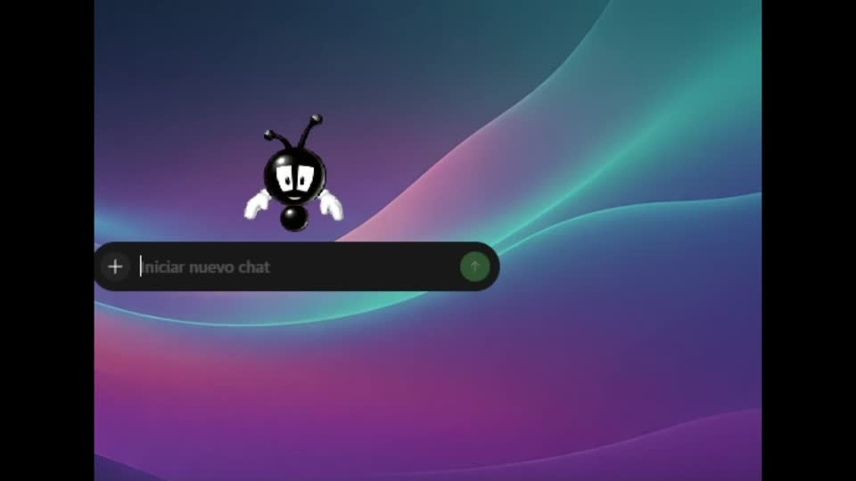
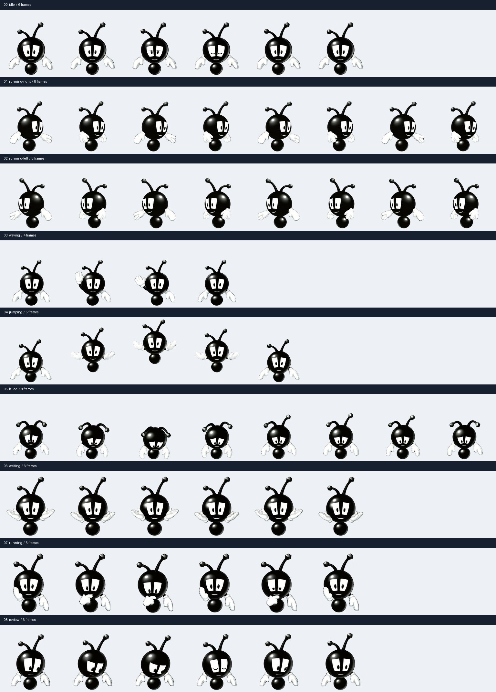

<div align="center">


# Buzzy · Codex Pet

**A little Theme Park World nostalgia for your workspace.**

A transparent, animated fan-made companion with nine states and 57 frames.

[](https://github.com/smouj/buzzy-pet-codex/releases/latest)
[](https://github.com/smouj/buzzy-pet-codex/actions/workflows/validate.yml)


[](LICENSE)

[Install Buzzy](#install-buzzy) · [Download](https://github.com/smouj/buzzy-pet-codex/releases/latest) · [Español](docs/README.es.md) · [Frame gallery](previews/contact-sheet.png)


</div>

## Meet Buzzy

Buzzy is a fan adaptation of the corner advisor from **Theme Park World / Sim Theme Park**, built from a supplied character reference and AI-assisted animation artwork. He floats, waves, jumps, waits, works and reviews alongside you.

This release packages the **same v1 sprite sheet that was successfully validated, created and activated through the Pets tools in the author's desktop environment**. Availability depends on your app, account and connected tools. The repository name follows the original Codex request; the tested installation path is the Pets integration in ChatGPT Work mode. This is an unofficial community project.

## Install Buzzy

### Easiest: ask your agent

Open a conversation in an environment with the **Pets tools** available and paste this:

```text
Install and activate Buzzy from https://github.com/smouj/buzzy-pet-codex.
Read docs/INSTALL.md and prompts/install-buzzy.md first. Download the
v1.0.1 release sprite sheet, verify its SHA-256, validate the exact file
with the Pets tool, show its animation preview, and use the supported
prepare-upload → create → select → list verification flow. Reuse an
existing verified installation when possible. Do not regenerate the art,
modify application internals, or claim success unless activation is verified.
If the Pets tools are unavailable, explain what is missing and stop there.
```

For the detailed, copy-ready instructions: **[English prompt](prompts/install-buzzy.md)** · **[Prompt en español](prompts/instalar-buzzy.es.md)**.

### Download the asset yourself

1. Download **[buzzy-mascota.png](https://github.com/smouj/buzzy-pet-codex/releases/download/v1.0.1/buzzy-mascota.png)**.
2. Keep the original PNG: it is the animation atlas, not a single portrait.
3. Follow **[the installation guide](docs/INSTALL.md)** to have your agent validate, upload and activate it.

No Python is required for installation through the agent. For a verified local download using Python's standard library:

```sh
git clone https://github.com/smouj/buzzy-pet-codex.git
cd buzzy-pet-codex
python scripts/download.py
```

The download helper verifies the pinned release and saves the PNG locally. **Activation still requires the Pets integration.** There is no standalone shell command that enables it in every Codex installation.

## See it in action

**[Watch the actual desktop demo (MP4)](https://github.com/smouj/buzzy-pet-codex/blob/main/previews/preview-pet-buzzy.mp4)** · [Download video](https://github.com/smouj/buzzy-pet-codex/raw/refs/heads/main/previews/preview-pet-buzzy.mp4)

<a href="https://github.com/smouj/buzzy-pet-codex/blob/main/previews/preview-pet-buzzy.mp4"></a>

The GIF below shows the native idle → jump → idle transition:


| Rest | Move right | Move left |
| :---: | :---: | :---: |
|  |  |  |
| **Wave** | **Jump** | **Failure reaction** |
|  |  |  |
| **Waiting for input** | **Working / thinking** | **Reviewing** |
|  |  |  |

GIF previews have a limited palette; the installable RGBA PNG retains soft alpha edges. Preview pacing is for demonstration; the host controls playback in the app.

<details>
<summary>View all 57 frames</summary>



Individual transparent PNGs are available in [frames/](frames/), named `00.png`, `01.png`, and so on in playback order.

</details>

## What's included

| Path | Purpose |
| --- | --- |
| `assets/buzzy-mascota.png` | Installable, validated v1 RGBA atlas |
| `pet.json` | Version, layout, hash, state counts and preview timings |
| `frames/<state>/*.png` | 57 exact pixel crops from the distributed atlas |
| `previews/` | Per-state GIFs, full loop, jump transition, contact sheet and video |
| `prompts/` | English and Spanish agent installation prompts |
| `docs/` | Installation, format, provenance and Spanish overview |
| `scripts/` | Verified download, distribution checks and preview exports |
| `SHA256SUMS` | Checksums for the atlas, frames, previews and metadata |

The release also contains a ZIP bundle and a separate frame archive. Neither contains a user-specific pet ID, upload session, credentials or private local paths.

## Technical details

| Property | Value |
| --- | --- |
| Sprite version | v1 |
| Image | PNG, RGBA, transparent background |
| Atlas dimensions | 1536 × 1872 px |
| Grid / cell | 8 × 9 / 192 × 208 px |
| Populated / unused cells | 57 / 15, unused cells fully transparent |
| State frame counts | 6, 8, 8, 4, 5, 8, 6, 6, 6 |
| Cursor gaze | Not included; v2 direction rows are absent |

The exact layout and state meanings are documented in **[docs/FORMAT.md](docs/FORMAT.md)**. Editing, resizing or optimizing the atlas changes its checksum and requires revalidation before installation.

## Verify or contribute

```sh
python -m pip install -r requirements.txt
python scripts/validate.py
```

The same checks run in GitHub Actions. They verify byte integrity, exact exported frames, metadata, occupied cells and transparent padding. They do not certify visual semantics or compatibility with future app versions.

To export previews and frames from the current atlas:

```sh
python scripts/export_previews.py
```

If you intentionally change generated files, review them and update the corresponding hashes before validation. See **[CONTRIBUTING.md](CONTRIBUTING.md)** for the release workflow.

## Credits and licensing

**Created by smouj013**, with Codex and AI-assisted artwork based on the supplied Buzzy reference. Theme Park World was developed by Bullfrog Productions and published by Electronic Arts. The original character and related names belong to their respective rights holders.

The **original scripts and documentation** in this repository are MIT licensed. The MIT license **does not cover the character, derived artwork, screenshots or video**; this project does not grant rights to third-party material. See **[THIRD_PARTY_NOTICES.md](THIRD_PARTY_NOTICES.md)** for attribution and scope. No affiliation or endorsement by OpenAI, Bullfrog or EA is implied.
