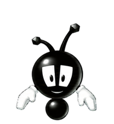
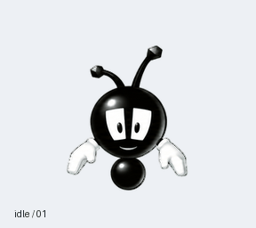

<div align="center">



# Buzzy · Mascota para Codex

**Un pequeño recuerdo de Theme Park World para tu escritorio.**

[](https://github.com/smouj/buzzy-pet-codex/releases/latest)
[](https://github.com/smouj/buzzy-pet-codex/actions/workflows/validate.yml)

[English](../README.md) · [Descargas](https://github.com/smouj/buzzy-pet-codex/releases/latest) · [Prompt completo](../prompts/instalar-buzzy.es.md)



</div>

## Instalación fácil

Pega esto en un agente que tenga disponibles las herramientas **Pets**:

```text
Instala y activa Buzzy desde https://github.com/smouj/buzzy-pet-codex.
Lee docs/INSTALL.md y prompts/instalar-buzzy.es.md. Descarga el PNG de
la release v1.0.1, verifica su SHA-256, valida el archivo exacto con Pets,
muestra su preview y completa el flujo preparar subida → crear →
seleccionar → verificar con la lista de mascotas. Reutiliza una
instalación existente si puedes verificarla. No regeneres el arte ni
modifiques archivos internos de la app. Si no tienes Pets, explica qué
falta y detente. Confirma el éxito solo tras comprobar que está activa.
```

También puedes descargar directamente **[buzzy-mascota.png](https://github.com/smouj/buzzy-pet-codex/releases/download/v1.0.1/buzzy-mascota.png)** y dárselo al agente con el [prompt completo](../prompts/instalar-buzzy.es.md).

La instalación probada usa la integración Pets en ChatGPT Work del entorno de escritorio del autor. Tener Codex o clonar el repositorio por sí solo no garantiza disponer de esa integración. El script de descarga obtiene el PNG, pero la activación requiere las herramientas Pets.

## Qué incluye

- PNG RGBA con fondo transparente y bordes limpiados.
- Nueve estados: reposo, movimiento a derecha e izquierda, saludo, salto, reacción de error, espera, trabajo y revisión.
- 57 frames PNG individuales, extraídos del archivo final sin modificar sus píxeles.
- GIF de cada estado, preview completa, transición de salto y hoja de contacto.
- [Vídeo real de la mascota en uso](../previews/preview-pet-buzzy.mp4).
- Guías, prompts en inglés y español, checksums y validación automática en GitHub Actions.

**Esta versión es v1 y no incluye miradas hacia el cursor.** La hoja mide 1536 × 1872 píxeles, con celdas de 192 × 208. El PNG es el archivo instalable; el vídeo y los GIF son demostraciones.

## Verificar los archivos

```sh
git clone https://github.com/smouj/buzzy-pet-codex.git
cd buzzy-pet-codex
python -m pip install -r requirements.txt
python scripts/validate.py
```

Para descargar y verificar solo el PNG, sin instalar dependencias:

```sh
python scripts/download.py
```

Consulta la [guía de instalación](INSTALL.md), el [formato](FORMAT.md) y la [procedencia](PROVENANCE.md).

## Créditos

**Creado por smouj013**, con ayuda de Codex y arte asistido por IA a partir de la referencia de Buzzy. El personaje original pertenece a sus respectivos titulares; no es una colaboración oficial con OpenAI, Bullfrog ni EA.

La licencia MIT cubre los scripts y la documentación originales. No cubre el personaje, el arte derivado ni el vídeo. Consulta [THIRD_PARTY_NOTICES.md](../THIRD_PARTY_NOTICES.md).
